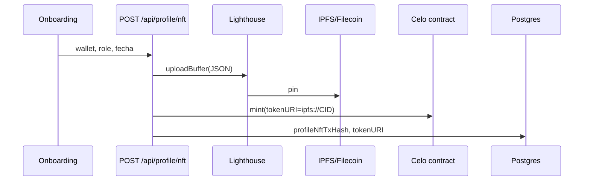

# Auditoría IPFS / almacenamiento descentralizado

**Fecha:** 2026-10-27  
**Relacionado:** [processors-inventory.md](./processors-inventory.md), Safety plan slice 6

## Veredicto

| Afirmación | ¿Correcta hoy? |
|------------|----------------|
| “No usamos IPFS en el Hub” (global) | **No** — hay ruta activa para NFT de perfil |
| “No guardamos datos clínicos en IPFS” | **Sí** — el JSON subido excluye intake/chat/bitácora |
| Pinata / web3.storage / nft.storage en runtime | **No** — paquetes en `package.json` sin imports en app |
| Arweave / Walrus / Arkiv | **No** en código |

## Ruta activa

1. Onboarding **Revisión** → `POST /api/profile/nft` (`components/onboarding/steps/StepRevision.tsx`).
2. `lib/profile-nft-metadata.ts` → **Lighthouse** (`uploadBuffer`) → CID → `ipfs://…`.
3. Mint en Celo (`lib/profile-nft-onchain.ts`) + `profileNftTokenURI` en Postgres.
4. UI enlaza `https://gateway.lighthouse.storage/ipfs/{CID}`.

**Contenido del JSON:** rol, wallet, fecha de registro (sin datos clínicos por diseño).

**Variables:** `LIGHTHOUSE_API_KEY`, `MOTUS_PROFILE_MINTER_PK`. Sin key, el upload falla; el onboarding puede continuar con warning en cliente.

## Legacy / ruido en repo

- `web3.storage`, `nft.storage`: dependencias sin uso en `.ts`/`.tsx`.
- Comentario en contrato que menciona web3.storage; implementación real es Lighthouse.

## Redacción sugerida para el aviso (borrador)

> Al completar el registro, podemos publicar metadatos del NFT de perfil clínico Motus (rol, dirección de wallet y fecha de registro, sin datos clínicos) en IPFS/Filecoin mediante Lighthouse, y registrar la URI en la blockchain Celo. Esa información puede ser **pública** y **no eliminable por completo** una vez publicada.

## Diagrama

